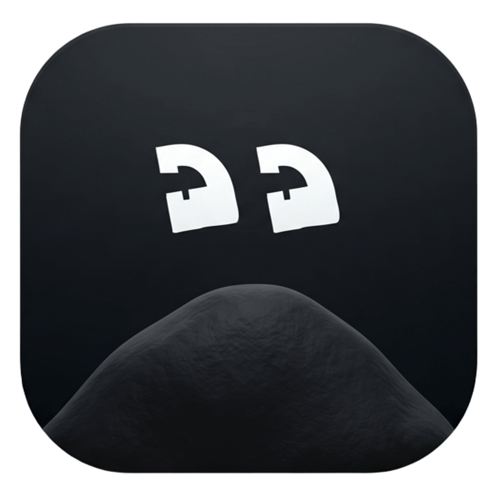

<div align="center">



# ❝ Quotal

### Ultra-Fast, 100% Offline AI Voice Dictation for Windows
*Instant real-time streaming speech recognition, 15 visual capsule styles, local SOTA models, and zero-latency cursor paste.*

[](https://microsoft.com/windows)
[](https://python.org)
[](https://github.com/PranavAnuvadia/Quotal)
[](https://github.com/PranavAnuvadia/Quotal)
[](#-privacy--offline-first)
[](LICENSE)

</div>

---

## ⚡ What is Quotal?

**Quotal** is a private, latency-optimized speech-to-text dictation utility engineered specifically for Windows. Instead of streaming your private voice to cloud servers, Quotal runs quantized, state-of-the-art ASR models **locally on your machine** (supporting CPU AVX2 and Vulkan/CUDA GPU acceleration).

Press and hold your hotkey, speak naturally, and release—your words are cleaned of stutters, self-corrections, and vocal fillers in 0ms, and instantly typed directly at your cursor into any active application (VS Code, WhatsApp, Slack, Browser, Word, Terminal, etc.).

---

## ✨ Flagship Features

### 🎙️ Real-Time Streaming & SOTA Speech Engines
* **⚡ Instant Streaming ASR (~50ms release latency)**:
  * Powered by **NVIDIA Nemotron 3.5 Streaming (0.6B)** on Vulkan GPU / ONNX runtime. Emits partial hypotheses live as you speak so text is ready the microsecond you release the hotkey.
* **🎯 Ultra-Accurate Offline Dictation (4.8% WER)**:
  * Integrated **NVIDIA Parakeet TDT 0.6B v3** for benchmark-grade English dictation under 800ms on CPU.
* **🌐 Multilingual & Romanized Speech**:
  * **Hinglish Swift** (`Oriserve/Whisper-Hindi2Hinglish-Swift`) outputs conversational Hindi in Romanized Latin script (*"kya haal hai bro"* ➔ *"theek hai, kal milenge"*).
  * Full support for OpenAI Whisper family (**Base**, **Small**, **Medium**, **Large v3**, **Large v3 Turbo**).

### 💊 15 Capsule Overlay Themes (Subprocess-Isolated)
Overlays run in dedicated PySide6 worker processes to guarantee **zero GIL contention, zero audio dropouts, and zero UI stutter**:
1. **Bloom**: Hardware-accelerated WebGL fluid shader orb with dynamic equalizer.
2. **Wispr**: Minimalist dark capsule with animated soundwave bars.
3. **Quotal**: Signature dark & light glassmorphic floating capsule.
4. **Aurora**: Polar iridescent animated gradient ribbon.
5. **Nothing (DotMatrix)**: Retro monochrome LED matrix aesthetic.
6. **Mercury**: Liquid chrome metallic finish with fluid lighting.
7. **Orbit**: Revolving planetary particle halo.
8. **Scribe**: Live word-by-word streaming transcript caption box.
9. **Opus**: Editorial typographic card with hanging quotation marks.
10. **Neon**: Cyberpunk glowing wireframe vector border.
11. **Flipboard**: Split-flap mechanical display ticker.
12. **Receipt**: Thermal paper tape rollout with monospace dot-print.
13. **Cassette**: Vintage magnetic tape reel rotation animation.
14. **CRT**: Scanline curved retro terminal display.
15. **Face**: Expressive companion with dynamic micro-animations.

> **Draggable & Persistent**: Click and drag any pill anywhere on your screen. Double-click to snap back to default bottom-center. Position is remembered across reboots.

### 🖥️ Redesigned Glassmorphic Dashboard
* **Quick Filter Chips**: Filter the model catalog by `((•)) Live preview` (streaming models) and `文A Translates` (multilingual translation).
* **Responsive Language Capability Strip**: In-card `.model-lang-strip` showing dynamic language badges (`[EN A]`, `[HI B-]`, `[ES A-]`, etc.) that wrap cleanly for 1 to 15+ active languages without table distortion.
* **Cellular Signal Speed Gauge**: 4-bar signal meter with explicit latency tags (`⚡ ~50ms`, `🚀 ~250ms`, `⏱️ ~800ms`).
* **Text Delivery Mode Toggle**: Choose between **Direct Paste** (auto-types directly into the active text field via 64-bit `SendInput` with modifier guards) or **Clipboard Only** right from the Settings tab.
* **Dictation History**: Browse previous transcriptions, view audio durations, word counts, and copy past entries with one click.

### 🧹 Instant Deterministic Text Cleaning & Personal Dictionary
* **0ms Latency Rules Engine**: Enabled by default (`enhancer_mode: "rules"`). Automatically removes vocal fillers (*"um"*, *"uh"*, *"hmm"*, *"ah"*), collapses stutters, drops self-corrections (*"meet at 5, wait no, 6 pm"* ➔ *"meet at 6 pm"*), expands contractions, and fixes phonetic homophones.
* **Custom Vocabulary (`dictionary.json`)**: Add custom spoken-to-written mapping for technical terms, project names, and slang (*"badi"* ➔ *"buddy"*, *"kube ctl"* ➔ *"kubectl"*).
* *Note on Neural Enhancer*: The experimental local Qwen 2.5 0.5B neural pass is currently a work-in-progress pending fine-tuning. The deterministic rules cleaner handles all active speech polish.

---

## 🏗️ Modular Architecture

Quotal is partitioned into clean, decoupled domain packages communicating over local IPC:

```
Quotal/
│
├── app.py                      # Core application controller & hotkey polling
├── run.bat                     # Quick console launcher
├── launch_silent.vbs           # Silent background starter (tray only)
├── version.py                  # Single source of truth for version
├── requirements.txt            # Python dependencies
├── settings.json               # Active user settings & model selection
├── history.jsonl               # Local dictation history
├── dictionary.json             # Custom spoken-to-written dictionary
│
├── 📂 engine/                  # 🎙️ Audio capture & Speech-to-Text models
│   ├── audio_recorder.py       # Non-blocking 16kHz PCM streaming recorder
│   ├── transcriber.py          # Dual engine (streaming vs offline dispatch)
│   ├── nemotron_streaming.py   # Real-time streaming ASR runner
│   ├── model_manager.py        # Model downloading & integrity checks
│   ├── gpu_pack.py             # GPU acceleration pack detection
│   └── languages.py            # Multilingual grades & language matrix
│
├── 📂 processing/              # ✍️ Text cleaning, enhancements & clipboard injection
│   ├── cleaner.py              # Regex rules & grammar engine
│   ├── smart_enhancer.py       # Phonetics, dictionary hook & enhancement pipeline
│   ├── history_manager.py      # History logging & daily stats
│   └── injector.py             # Windows keyboard typing / clipboard injection
│
├── 📂 ui/                      # 🎨 Dashboard & System Tray
│   ├── tray_manager.py         # System tray icon & context menus
│   └── dashboard/              # Edge Chromium (WebView2) interface
│       ├── dashboard_host.py   # API endpoints & HTTP host
│       ├── dashboard_ui.py     # Webview window lifecycle
│       └── dashboard.html      # Glassmorphic dashboard UI & scripts
│
├── 📂 pills/                   # 💊 15 Capsule Overlay Themes (Subprocess Isolated)
│   ├── overlay_pill.py         # Master pill orchestrator
│   ├── preview_pill.py         # Pill previewer
│   ├── wispr/                  # wispr_pill.py + wispr_qt_bridge.py
│   ├── quotal/                 # quotal_pill.py + quotal_qt_bridge.py
│   ├── aurora/                 # aurora_pill.py + aurora_qt_bridge.py
│   ├── nothing/                # dotmatrix_pill.py + nothing_qt_bridge.py
│   ├── cassette/               # cassette_pill.py + cassette_qt_bridge.py
│   ├── crt/                    # crt_pill.py + crt_qt_bridge.py
│   ├── face/                   # face_pill.py + face_qt_bridge.py
│   ├── flipboard/              # flipboard_pill.py + flipboard_qt_bridge.py
│   ├── mercury/                # mercury_pill.py + mercury_qt_bridge.py
│   ├── neon/                   # neon_pill.py + neon_qt_bridge.py
│   ├── opus/                   # opus_pill.py + opus_qt_bridge.py
│   ├── orbit/                  # orbit_pill.py + orbit_qt_bridge.py
│   ├── receipt/                # receipt_pill.py + receipt_qt_bridge.py
│   ├── scribe/                 # scribe_pill.py + scribe_qt_bridge.py
│   └── bloom/                  # bloomgl_host.py, pulse_host.py, web_pill_host.py
│
├── 📂 core/                    # ⚙️ Platform & Lifecycle Utilities
│   ├── paths.py                # Central install & asset path resolver
│   ├── settings_manager.py     # Settings file read/write
│   ├── single_instance.py      # Mutex single-instance guard
│   ├── win_startup.py          # Windows Run registry & startup shortcut
│   ├── make_shortcut.py        # Desktop & Start Menu shortcut creator
│   └── updater.py              # Background OTA update checker
│
├── 📂 assets/                  # 🖼️ Application branding & icons
│   ├── quotal.ico
│   ├── quotal_icon.ico
│   └── quotal_icon.png
│
└── 📂 installer/               # 📦 Inno Setup packaging scripts
    ├── quotal.iss
    ├── build.py
    └── build_gpu_pack.py
```

---

## 🚀 Getting Started

### 1. Prerequisites
- **Operating System**: Windows 10 (Build 19041+) or Windows 11 (64-bit).
- **Python**: Python **3.10, 3.11, or 3.12** (64-bit). Ensure **"Add python.exe to PATH"** is checked.
- **Microsoft Edge WebView2**: Pre-installed on Windows 11 and modern Windows 10 updates.
- **Microphone**: Ensure microphone access is allowed in **Windows Settings > Privacy & security > Microphone**.

### 2. Installation

1. **Clone the repository**:
   ```powershell
   git clone https://github.com/PranavAnuvadia/Quotal.git
   cd Quotal
   ```

2. **Create and activate a virtual environment**:
   ```powershell
   python -m venv .venv
   .\.venv\Scripts\activate
   ```

3. **Install dependencies**:
   ```powershell
   pip install -r requirements.txt
   ```
   > **Note for NVIDIA Users**: `requirements.txt` includes `nvidia-cublas-cu12` and `nvidia-cudnn-cu12`. Quotal automatically maps these libraries directly to your Windows DLL path, enabling full GPU acceleration without needing a manual CUDA Toolkit installation!

4. **Create Desktop Shortcut**:
   ```powershell
   python core/make_shortcut.py
   ```

### 3. Running Quotal

| Method | Command / Action | Description |
| :--- | :--- | :--- |
| **Silent Tray Mode** *(Recommended)* | Double-click `launch_silent.vbs` | Runs completely in the background in your system tray (zero terminal window). |
| **Standard Mode** | `python app.py` or double-click `run.bat` | Starts Quotal with console output for debugging. |
| **Desktop Shortcut** | Double-click `Quotal.lnk` on your Desktop | Launches your configured standalone Quotal app. |

---

## ⌨️ How to Use

1. **Focus any text input**: Click your cursor inside VS Code, WhatsApp, Slack, Word, Chrome, Notion, or terminal.
2. **Hold Hotkey**: Press and hold **Right Alt** (or **F8**).
   - Your selected floating capsule overlay will appear on screen.
3. **Speak Naturally**: Talk clearly into your microphone. If using a streaming model (*Nemotron 3.5*), partial words stream live into caption capsules.
4. **Release Key**: Release the hotkey.
   - Text is cleaned in 0ms and instantly typed directly at your cursor via Win32 `SendInput`!
5. **Open Dashboard**: Click the Quotal icon in your System Tray (next to the clock) or click **Change languages / Settings** to open the dashboard.

---

## ⚙️ Configuration (`settings.json`)

All persistent configurations are saved in `settings.json`:

```json
{
  "model_key": "nemotron",
  "selected_languages": ["en"],
  "device": "auto",
  "ai_enhance": true,
  "enhancer_mode": "rules",
  "strip_hesitations": true,
  "audio_chimes": true,
  "paste_mode": "direct",
  "pill_style": "wispr",
  "pill_x": null,
  "pill_y": null,
  "theme": "dark"
}
```

### Customizing Hotkeys
The default hardware hotkeys are polled at high frequency via Win32 `GetAsyncKeyState`:
* `VK_RMENU` (`0xA5`): **Right Alt** (Default)
* `VK_F8` (`0x77`): **F8** (Universal alternative)

To customize hotkeys, edit `VK_RMENU` and `VK_F8` in `app.py`.

### Custom Personal Dictionary (`dictionary.json`)
Create or edit `dictionary.json` in the root folder to define custom spoken replacements:
```json
{
  "badi": "buddy",
  "kube ctl": "kubectl",
  "quotal": "Quotal"
}
```

---

## 📦 Packaging & Installer

Quotal includes full Inno Setup packaging scripts to build a standalone installer:

```powershell
# Compile QuotalSetup.exe via Inno Setup 6:
python installer/build.py

# Package optional GPU acceleration pack:
python installer/build_gpu_pack.py
```
Compiled setup files are placed into `installer/Output/`.

---

## 🔒 Privacy & Offline-First

* **100% On-Device**: Zero audio, speech waveforms, or transcripts are ever transmitted to any external server.
* **No Telemetry**: No tracking, analytics, or background telemetry.
* **Local Storage**: Your dictation history is saved purely to your local `history.jsonl` file and can be cleared at any time from the Dashboard.

---

## 📄 License

This project is open-source and licensed under the [MIT License](LICENSE).
