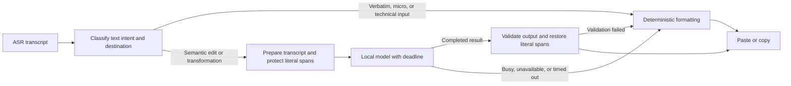

# Quotal cognitive text engine

Quotal treats a completed dictation as an editing request. The engine receives the ASR transcript, a writing style, the foreground application captured at hotkey press, and optional previous text from the caller. The engine returns a string for the existing paste or clipboard step.

Choose a cleanup mode and writing style in **Settings → Text cleanup**. Existing settings retain their selected mode.



## Routing and behavior

| Mode | Behavior |
| --- | --- |
| Verbatim (`off`) | Passes through the transcript from the speech engine after Quotal's language policy and trims outer whitespace. |
| Instant tidy (`rules`) | Uses the existing rules for hesitations, stutters, lexical replacements, number and time normalization, spoken punctuation, and predictable backtracking. |
| Hybrid (`hybrid`) | Uses rules for ordinary dictation of up to three words and short, already punctuated prose. The local editor handles longer or explicitly transformational dictation when available. |
| Neural polish (`llm`) | Uses the same fast path for micro-dictation and technical input. Other text can use the local editor. |

Default adapts to the destination. Chat favors conversational wording and email favors professional wording. The document profile gives the model layout guidance for paragraphs, headings, and lists. Terminal input and recognized code take the deterministic path to preserve identifiers, indentation, syntax, and flags. An explicit voice directive takes precedence over the chosen style.

Spoken directives work at the start of dictation or after a phrase boundary at the end, for example:

- **Summarize the following:** We approved the budget. The venue is still pending.
- **Make this an email to Sarah:** I can meet Friday afternoon.
- **Translate to French:** We will meet tomorrow morning.
- Buy milk, then call Mom. **Convert this to bullet points.**
- **Action items:** Priya sends the draft Friday and Lee reviews it Monday.

A pause transcribed as punctuation, the spoken word “colon,” or a line break helps resolve where a directive ends, especially with multiword recipient names and less common language names. A quoted command or a conversational reference such as “Can you ask Sarah to summarize the notes?” stays in the dictation. The email operation produces a draft for insertion.

The rules path can draft a basic email and format bullet lists and action items. If inference is unavailable, summaries retain all distinct sentences in the cleaned source. Explicit translation requests keep the directive and source together so the requested language is still visible.

## Model and prompts

[The prompt source](../processing/cognitive_text.py) contains the exact system prompt, per-operation and per-style instructions, destination guidance, and few-shot examples. Each call selects a relevant example. For editing, that can be a phonetic repair, a last-intent correction, or a rambling announcement. A structured record carries the transcript, selected operation, style, destination category, and the last 512 characters of caller-supplied context. The model receives the category only for application context.

The preparation step resolves explicit time revisions, recognizes spoken punctuation, and protects personal dictionary replacements, snippets, and recognizable literals such as email addresses, URLs, flags, and identifiers. The formatter restores protected spans and normalizes list markers. It rejects empty, incomplete, malformed, or unexpectedly long outputs, invalid placeholder usage, and some lost numeric literals. These checks catch specific integrity failures. Semantic correctness depends on the model and the evidence in the transcript.

The existing Qwen 2.5 0.5B CTranslate2 conversion loads from `models/qwen2.5-0.5b-ct2`, using the tokenizer in `models/qwen2.5-0.5b`. CTranslate2 uses CUDA when available and CPU otherwise. A development environment with CUDA-enabled PyTorch can also use the official Qwen checkpoint and tokenizer from the dashboard download. The installer currently excludes PyTorch, so use CTranslate2 for that installation. [CTranslate2 generation reference](https://opennmt.net/CTranslate2/python/ctranslate2.Generator.html) · [Qwen checkpoint and tokenizer](https://huggingface.co/Qwen/Qwen2.5-0.5B-Instruct/tree/2b01de6d1108f9b2b5e46a726aa678a359b6c03b)

To evaluate a different instruction-tuned model, set `QUOTAL_COGNITIVE_MODEL` before launching Quotal. Point it at a local directory containing its CTranslate2 conversion and matching Transformers tokenizer with a chat template. A Qwen 2.5 1.5B Instruct conversion is one candidate to evaluate against the same cases and deadlines. [CTranslate2 Transformers conversion guide](https://opennmt.net/CTranslate2/guides/transformers.html)

## Latency and verification

Short, ordinary dictation uses synchronous rules. The app warms the model in the background when neural editing is selected. A single model worker owns inference. A concurrent request falls back immediately if the worker is occupied. The normal model wait is bounded at 230 ms from the start of enhancement. Long inputs and semantic commands such as translation and summaries allow up to four seconds for a complete batch. Source prompts over 4,096 tokens use rules. These budgets apply to enhancement. The app logs ASR and enhancement time separately.

```powershell
python -m processing.smart_enhancer
python -m unittest discover -s tests -v
.\.venv\Scripts\python.exe -u -m tests.test_cognitive_enhancer --live
```

The unit tests check routing, deterministic edits, and output verification with controlled model responses. The live run prints before and after text, elapsed time, and accuracy checks for the three supplied transcripts and the voice commands. It returns a nonzero exit code on a missed target edit.

On the RTX 3050 with Qwen 2.5 0.5B, the latest run measured 4.0 ms p95 for micro-dictation, 237–241 ms for the tested normal requests, and 31.5 seconds of background model warm-up. The live run passed revision, bullet, email, action-item, and translation checks. It missed the target acoustic repairs, the rambling rewrite, and the semantic summary. The summary guard returned the source facts when the generated summary omitted the pending venue.
